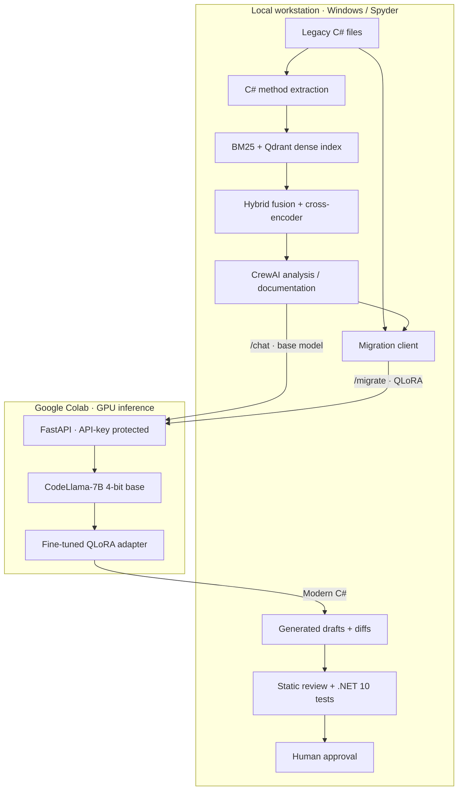
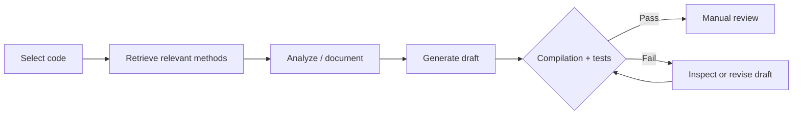

<div align="center">

# CodeMigrate AI

**A retrieval-assisted, multi-agent system for migrating legacy C#/.NET code**

*QLoRA fine-tuning · hybrid RAG · CrewAI · agent memory · C# compilation and behavioral testing*


</div>

CodeMigrate AI is an experimental code-modernization assistant that indexes C# source code, retrieves relevant methods, analyzes migration requirements, generates modern .NET drafts with a fine-tuned language model, and checks the drafts with static analysis, compilation, and selected behavioral tests.

The system uses **a 4-bit quantized `codellama/CodeLlama-7b-Instruct-hf` base model with a QLoRA adapter** for C# migration. An independent chat endpoint supports the CrewAI analysis and documentation agents. GPU inference runs remotely in Google Colab; the retrieval pipeline, agent orchestration, code review, and .NET validation run on Windows.

> **Research / portfolio status.** This repository documents a working prototype, not an unattended enterprise migration product. A generated draft can compile and still change a public contract. All modifications are subject to human review; the batch pipeline does not overwrite original C# files.

## Highlights

| Component | Implementation |
| --- | --- |
| Migration LLM | CodeLlama-7B-Instruct + QLoRA/PEFT adapter, 4-bit base weights |
| Fine-tuning | Hugging Face Transformers, TRL SFTTrainer, PEFT, bitsandbytes, PyTorch |
| Hyperparameter optimization | Optuna TPE search on validation loss |
| Code understanding | Method-level C# extraction; syntax-aware chunking |
| Retrieval | BM25, dense embeddings in Qdrant, Reciprocal Rank Fusion, cross-encoder reranking |
| Agent orchestration | CrewAI: code analysis, documentation, migration coordination |
| Memory | Scoped agent memory with embeddings/vector retrieval |
| Inference API | FastAPI; authenticated `/migrate`, `/chat`, and `/health` endpoints |
| Verification | Static checks, `.NET 10` compiler, selected legacy-vs-modern behavioral tests |
| Evaluation | Held-out execution tests, LLM-as-a-Judge, paired bootstrap CIs, RAGAS, retrieval ranking metrics |

## End-to-end architecture



The two generation routes have different purposes:

1. **`POST /chat`**: reasoning and source explanation for CrewAI agents; in the tested setup, it uses the base CodeLlama model.
2. **`POST /migrate`**: migration instruction + legacy C# source → fine-tuned QLoRA-generated C# draft.

The Colab tunnel uses a temporary Cloudflare URL. It is **development infrastructure**, not a permanent public deployment. API credentials must never be committed.

### Local pipeline



The system retains raw generations, draft C# files, unified diffs, agent notes, and validation reports for later inspection. These local outputs are excluded from Git by default.

## Repository layout

The primary folders and scripts used in the current Windows project are:

```text
CodeMigrateAI/
├── codemigrate/                         # Core library
│   ├── agents/                          # CrewAI agent definitions
│   ├── chunking/                        # Source-aware C# chunks
│   ├── llm/                             # Remote inference clients
│   ├── memory/                          # Agent memory configuration
│   ├── pipeline/                        # Batch migration orchestration
│   └── retrieval/                       # BM25, dense, hybrid, reranking
├── evaluation/
│   ├── ragas/                           # Retrieval + RAG answer evaluation
│   └── batch_validation/                # Controlled behavioral test fixtures
├── legacy/                              # Small C# input examples
├── tests/                               # Python/unit/integration tests
├── LLM Fine Tuning Colab Notebooks/
│   ├── CodeMigrateAI_01_CodeLlama7B_QLoRA_Pilot_and_Evaluation.ipynb
│   ├── CodeMigrateAI_02_Dataset_Engineering_and_QLoRA_Retraining.ipynb
│   └── CodeMigrateAI_03_Model_Inference_Service_APIs.ipynb
├── run_batch_migration.py
├── run_batch_validation.py
├── run_batch_configuration_behavior.py
├── run_code_analysis_agent.py
├── run_documentation_agent.py
├── run_code_migration_agent.py
└── run_multi_agent_pipeline.py
```

`models/`, `data/`, `outputs/`, local databases, temporary files, and credentials remain on the developer's machine or private cloud storage. Their contents are not included in the published source tree.

## Fine-tuning approach

### Model and dataset

- **Base model:** [`codellama/CodeLlama-7b-Instruct-hf`](https://huggingface.co/codellama/CodeLlama-7b-Instruct-hf).
- **Task:** transform legacy .NET Framework C# into modern .NET code while retaining observable behavior, public method names, filtering logic, and null semantics unless a change is explicitly required.
- **Training examples:** curated legacy/modern pairs covering configuration APIs, ASP.NET MVC/HTTP context, and Entity Framework → EF Core migrations.
- **Training format:** instruction + legacy source in the prompt; modern C# completion is the supervised target. Loss is calculated on the completion portion.
- **Split (v2.1):** 39 training and 9 validation examples, with group-level leakage checks. A separate 17-example held-out set was used for the final comparison.
- **Runtime:** NVIDIA L4 in Google Colab; 4-bit base weights and trainable LoRA adapters.

Some candidate examples came from audited public repositories; changed filenames or methods were **not automatically accepted** as migration pairs. The final curated examples were separately reviewed and, where available, compiled and behavior-tested before training.

### LoRA mathematics

For a frozen pretrained weight matrix $W_0\in\mathbb{R}^{d_{out}\times d_{in}}$, LoRA learns a low-rank update:

$$
W = W_0 + \Delta W, \qquad \Delta W = \frac{\alpha}{r}BA,
$$

where $A\in\mathbb{R}^{r\times d_{in}}$, $B\in\mathbb{R}^{d_{out}\times r}$, $r$ is the adapter rank, and $\alpha$ controls the update scale. Only the small $A,B$ matrices are trained.

QLoRA stores the frozen base model in 4-bit form and trains the low-rank adapter around it:

$$
h = \mathrm{dequant}(W_{4\mathrm{bit}})x + \frac{\alpha}{r}BAx.
$$

This reduces training memory relative to updating all full-precision model parameters. See the original [LoRA](https://arxiv.org/abs/2106.09685) and [QLoRA](https://arxiv.org/abs/2305.14314) papers for the methodology.

### Supervised fine-tuning objective

Given prompt tokens $x$ and target completion tokens $y_1,\ldots,y_T$, the completion-only teacher-forced negative log-likelihood is:

$$
\mathcal{L}_{\mathrm{SFT}}(\theta) =
-\frac{1}{T}\sum_{t=1}^{T}\log p_{\theta}(y_t\mid x,y_{<t}).
$$

Prompt tokens are masked from the loss; they provide context but do not count as supervised targets. A shorter loss on a small validation set does not guarantee equivalent execution behavior.

### Optuna hyperparameter search

Optuna's Tree-structured Parzen Estimator (TPE) was used for a small-budget search over LoRA rank, scaling, dropout, learning rate, weight decay, warmup fraction, and schedule. The objective minimized validation loss:

$$
\lambda^* = \arg\min_{\lambda\in\Lambda}
\mathcal{L}_{\mathrm{val}}\big(\mathrm{Train}(\theta_0,\lambda)\big).
$$

Selected v2.1 training configuration:

| Parameter | Value |
| --- | ---: |
| LoRA rank $r$ | 16 |
| LoRA $\alpha$ | 16 |
| LoRA dropout | 0.00 |
| Learning rate | $2.5769\times10^{-4}$ |
| Weight decay | 0.06 |
| Warmup ratio | 0.10 |
| LR schedule | Cosine |
| Optimizer steps | 18 |
| Maximum sequence length | 768 |
| Trainable parameters | 39,976,960 (about 0.59% of reported total) |

**Loss results:** v2.0 validation loss = **0.055013**; v2.1 validation loss = **0.043804** (20.38% relative reduction on the reported validation split). The v2.1 training loss was **0.056571**. Optuna and the loss comparison are exploratory, given the small dataset.

## Retrieval: lexical, semantic, hybrid, reranking

The retrieval task is to find the right methods and related source evidence from natural-language requests such as *"Find the method that checks whether a customer is active."*

### BM25 (lexical)

For query $q$ and document $d$, a common BM25 form is:

$$
\mathrm{BM25}(q,d)=\sum_{t\in q}\mathrm{IDF}(t)
\frac{f(t,d)(k_1+1)}{f(t,d)+k_1\left(1-b+b\frac{|d|}{\overline{|d|}}\right)},
$$

where $f(t,d)$ is the term frequency, $|d|$ the document length, and $\overline{|d|}$ the mean document length. BM25 often helps with exact identifiers and API names.

### Dense retrieval

An embedding model converts the query and each method chunk into vectors. Similarity can be measured with cosine similarity:

$$
\mathrm{sim}(q,d)=\frac{\mathbf e_q^\top\mathbf e_d}
{\|\mathbf e_q\|_2\,\|\mathbf e_d\|_2}.
$$

Qdrant stores and searches these vectors. Dense search can retrieve related code even when the query and method use different words.

### Reciprocal Rank Fusion (RRF)

BM25 and dense results can be combined without directly adding scores that have incompatible scales:

$$
\mathrm{RRF}(d)=\sum_{s\in\{\mathrm{BM25},\mathrm{dense}\}}
\frac{1}{k+\mathrm{rank}_s(d)}.
$$

$k$ is a fusion constant. The project then uses a cross-encoder to score each query–code pair jointly and rerank candidates:

$$
s_{\mathrm{CE}}(q,d)=f_{\phi}([q;d]).
$$

Cross-encoder scores are relative ranking signals, not calibrated probabilities. See [Qdrant's hybrid-search and reranking documentation](https://qdrant.tech/documentation/tutorials-basics/reranking-hybrid-search/).

## CrewAI agents and memory

The local pipeline uses specialized agents and shared retrieval evidence:

| Agent / component | Role |
| --- | --- |
| Code Analysis Agent | Explain public contracts, dependencies, conditions, and migration concerns based on supplied C# source. |
| Documentation Agent | Draft source-grounded behavior notes with file/method references; flag unsupported claims. |
| Migration component | Send migration instructions + C# code to the QLoRA `/migrate` endpoint; store drafts and diffs. |
| Scoped memory | Persist verified project guidance and retrieve relevant notes through an embedding-backed store. |
| Validation stage | Compile modern C# and compare selected old/new behaviors before any human-approved integration. |

Agent memory is intended for **verified migration rules**, not for silently treating model-generated guesses as facts. Documentation drafts are reviewed before new claims are saved. The Documentation Agent was updated to use a smaller, frozen evidence window and to check citations and null-fallback explanations.

## Evaluation

### Held-out migration benchmark (17 examples)

The independent set contained **3 configuration**, **6 Entity Framework**, and **8 ASP.NET Core** scenarios. All 17 reference implementations passed the project-specific reference tests. The three models were evaluated on the same scenarios.

| Metric | Base CodeLlama | QLoRA v2.0 | QLoRA v2.1 |
| --- | ---: | ---: | ---: |
| Compilation rate | 2/17 · 11.76% | 14/17 · 82.35% | **14/17 · 82.35%** |
| Behavioral pass rate | 2/17 · 11.76% | 14/17 · 82.35% | **14/17 · 82.35%** |
| Code-only output rate | 0% | 100% | 100% |
| EOS completion rate | 52.94% | 100% | 100% |
| Mean generation latency | 11.12 s | **9.47 s** | 9.77 s |
| LLM-Judge overall (1–5) | 3.853 | 4.471 | **4.647** |

Behavioral accuracy by family:

| Family | Base | v2.0 | v2.1 |
| --- | ---: | ---: | ---: |
| Configuration (3) | 0/3 | 0/3 | 1/3 |
| Entity Framework (6) | 0/6 | 6/6 | 6/6 |
| ASP.NET Core (8) | 2/8 | 8/8 | 7/8 |

**Important limitation:** configuration migration remained weak even after adding training examples. In one diagnostic case, the model incorrectly appended `.ConnectionString` after `IConfiguration.GetConnectionString(...)`. Compilation and behavioral tests are therefore required, especially for configuration code.

### LLM-as-a-Judge

An independent `Qwen/Qwen2.5-Coder-7B-Instruct` model scored each output against the migration task and reference code on four 1–5 scales. These are model-based ratings, not execution proofs.

| Criterion | Base | v2.0 | v2.1 |
| --- | ---: | ---: | ---: |
| Semantic behavior | 3.882 | 4.471 | **4.529** |
| Modern API use | 3.941 | 4.588 | **4.647** |
| Public contract preservation | 3.765 | 4.412 | **4.706** |
| Output format | 3.824 | 4.412 | **4.706** |

### Paired bootstrap confidence intervals

For model $m$, behavioral accuracy across $n$ scenarios is:

$$
\widehat{A}_m = \frac{1}{n}\sum_{i=1}^{n} y_{m,i}.
$$

Here $y_{m,i}\in\{0,1\}$ indicates whether model $m$ passes scenario $i$. To compare models $A$ and $B$, resample **scenario indices in pairs** (the same indices for both models) and recompute:

$$
\widehat{\Delta}^{(b)} = \frac{1}{n}\sum_{i\in I_b}
\big(y_{A,i}-y_{B,i}\big).
$$

The percentile interval is the 2.5th–97.5th percentile of bootstrap differences. Reported results:

| Comparison | Observed accuracy difference | 95% paired bootstrap CI | W / L / Tie |
| --- | ---: | ---: | ---: |
| v2.0 − base | +0.7059 | [+0.4706, +0.8824] | 12 / 0 / 5 |
| v2.1 − base | **+0.7059** | **[+0.4706, +0.8824]** | 12 / 0 / 5 |
| v2.1 − v2.0 | 0.0000 | [−0.1765, +0.1765] | 1 / 1 / 15 |

Individual 95% bootstrap accuracy intervals: base **[0.0000, 0.2941]**; v2.0 and v2.1 **[0.6471, 1.0000]**. With only 17 scenarios, uncertainty remains substantial. The held-out results show a gain over the base model on this particular benchmark; they do **not** establish a universal migration success rate.

### Retrieval benchmark (8 labeled queries)

| Retrieval | Hit@5 | MRR | RAGAS ID precision | RAGAS ID recall |
| --- | ---: | ---: | ---: | ---: |
| BM25 | 1.000 | **1.000** | 0.285 | 1.000 |
| Dense | 1.000 | 0.750 | 0.250 | 1.000 |
| Hybrid | 1.000 | 0.750 | 0.250 | 1.000 |
| Cross-encoder reranked | 1.000 | 0.792 | 0.250 | 1.000 |

Here, $\mathrm{MRR}=\frac{1}{Q}\sum_{q=1}^{Q}\frac{1}{\mathrm{rank}_q}$ for the first relevant result. Recall@5 / Hit@5 was perfect **on these eight labeled queries**, but BM25 ranked the expected method higher than the semantic variants. Reranking did not consistently improve rankings. Gold labels and source-method identity should be audited before expanding claims.

### RAGAS answer evaluation (8 questions)

RAGAS was run against the Documentation Agent's generated answers using `gpt-4o-mini` as the evaluator and `text-embedding-3-small` for answer relevancy. The v2 prompts were evaluated on the same frozen retrieved evidence as v1.

| Metric | Documentation v1 | Documentation v2 | Difference | 95% paired CI for difference |
| --- | ---: | ---: | ---: | ---: |
| Faithfulness | 0.448 | **0.508** | +0.061 | [−0.086, +0.240] |
| Answer relevancy | 0.549 | **0.616** | +0.067 | [−0.026, +0.185] |
| Context precision | 0.542 | 0.542 | 0.000 | [0.000, 0.000] |
| Context recall | 1.000 | 1.000 | 0.000 | [0.000, 0.000] |

- **Faithfulness:** whether answer claims are supported by retrieved source evidence.
- **Answer relevancy:** whether the answer addresses the user question.
- **Context precision:** how well relevant context is prioritized in retrieved evidence.
- **Context recall:** how much of the reference-relevant context is retrieved.

The 95% intervals for the v1→v2 faithfulness and relevancy improvements **include zero**. Results are directional only; eight questions are not sufficient to establish a reliable improvement.

### MC Dropout pilot

A separate exploratory dropout study used 30 stochastic forward passes on one reference completion. The measured mean epistemic mutual information was approximately **0.000011** for that input. This is a **single-example diagnostic**, not a calibrated uncertainty estimate over the migration distribution.

### Integrated batch validation (6 files)

The Windows/Spyder pipeline generated six C# drafts. After reviewing and **manually correcting** a defective `Configuration.AppSettings` transformation and a changed generic return annotation:

| Check | Result |
| --- | --- |
| Original-file integrity | 6/6 PASS |
| Combined .NET 10 compilation | PASS |
| Explicit pure-method behavioral cases | 16/16 PASS |
| `NotificationSettings` fallback cases | 4/4 PASS |
| Original source files modified | No |

These results validate the **reviewed drafts**, not the untouched first-pass output. Four files with no recognized legacy API received unnecessary cosmetic/model changes; these are flagged for human review. The configuration regression harness uses a `NameValueCollection` shim for legacy `AppSettings` indexed access and real in-memory `IConfiguration` for the modern version.

## Running the project

### Prerequisites

- Windows 11 with Python/Conda environment (the tested local environment used Python 3.11).
- .NET 10 SDK for compilation/behavioral tests.
- Running Qdrant service for dense/hybrid retrieval.
- An authenticated remote inference endpoint serving the base CodeLlama and the project's fine-tuned adapter.
- Local dependencies such as CrewAI, Qdrant client, sentence-transformers, rank-bm25, FastAPI client libraries, and RAGAS for evaluation. Training requires PyTorch, Transformers, PEFT, TRL, bitsandbytes, and Optuna in a CUDA-capable environment.

Dependencies and compatible package versions should be installed from a tested environment manifest before treating this as a one-command deployment. The Windows and Colab environments have different requirements.

### Configuration

Copy the existing `.env.example` to `.env`, populate the actual remote API URL and credentials, and consult `API_CONFIGURATION_README.md` and `codemigrate/settings.py` for the names consumed by your local version. A representative endpoint setting is:

```dotenv
CODEMIGRATE_API_URL=https://YOUR-TEMPORARY-TUNNEL.trycloudflare.com
```

Never commit `.env`, private API keys, Hugging Face tokens, or public tunnel credentials. Temporary Cloudflare hostnames change when the tunnel restarts.

### Example entry points

From the project root in Spyder:

```python
%runfile C:/CodeMigrateAI/run_migration_pipeline.py --wdir
```

For the batch migration workflow:

```python
%runfile C:/CodeMigrateAI/run_batch_migration.py --wdir
%runfile C:/CodeMigrateAI/run_batch_validation.py --wdir
%runfile C:/CodeMigrateAI/run_batch_configuration_behavior.py --wdir
```

The batch script starts in `DRY_RUN=True` mode. Live inference requires changing the setting to `False` and explicitly approving the upload of source code to Colab. Compilation and execution of generated C# also require an explicit `RUN` confirmation. Do not run these tests on untrusted code without an isolation boundary.

## Security, data handling, and limitations

1. **Review before migration.** Generation, compilation, and unit test success do not automatically imply semantic equivalence or safe deployment.
2. **Generated code is executable input.** The development-time `.NET` validation harness is not sandboxed. Its `RUN` confirmation is intentional.
3. **Source confidentiality.** Remote inference transmits selected source code over HTTPS. Check for secrets, proprietary code, and authorization before sending it.
4. **Credentials.** `.env`, adapter weights, tokens, runtime stores, and private datasets are excluded from Git. The published notebooks have saved execution outputs cleared; still review cell source for embedded secrets before committing.
5. **Limited benchmark size.** The held-out LLM comparison uses 17 examples; RAGAS uses 8 questions. Confidence intervals and task-specific tests are shown to avoid overclaiming.
6. **Model licensing.** Download/use of CodeLlama is governed by its own [model license and terms](https://huggingface.co/codellama/CodeLlama-7b-Instruct-hf). Fine-tuned adapter weights are separate from the base model and are not included here.

## References

- Hu et al., [LoRA: Low-Rank Adaptation of Large Language Models](https://arxiv.org/abs/2106.09685) (2021).
- Dettmers et al., [QLoRA: Efficient Finetuning of Quantized LLMs](https://arxiv.org/abs/2305.14314) (2023).
- [Hugging Face PEFT](https://huggingface.co/docs/peft/index), [TRL](https://huggingface.co/docs/trl/index), and [Transformers](https://huggingface.co/docs/transformers/index).
- [Optuna documentation](https://optuna.readthedocs.io/en/stable/).
- [Qdrant hybrid search and reranking](https://qdrant.tech/documentation/tutorials-basics/reranking-hybrid-search/).
- [CrewAI documentation](https://docs.crewai.com/) and [memory guide](https://docs.crewai.com/concepts/memory).
- [RAGAS documentation](https://docs.ragas.io/en/stable/).
- [FastAPI documentation](https://fastapi.tiangolo.com/).
- [Microsoft .NET documentation](https://learn.microsoft.com/en-us/dotnet/).

## Project status

Core prototype and experimental evaluation completed; code review, reliable dependency locking, a permanent inference host, larger out-of-distribution migration tests, and CI automation are remaining engineering work.

**Maintainer:** [Mehmet Sener](https://github.com/MehmetSenerMS)

**Purpose:** applied LLM fine-tuning, retrieval, agent orchestration, and executable evaluation for legacy software modernization.
